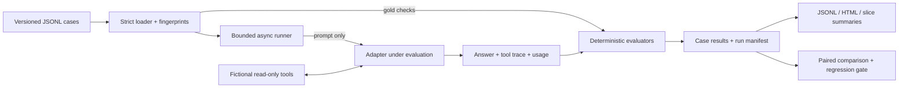

# Architecture and design decisions

## Problem

Final-answer scoring alone misses wrong-entity lookups, forbidden actions and inefficient agent loops. This framework evaluates a task as an execution with an answer, tool events and observed resource usage. It produces an auditable artifact and a CI decision from the same records.

## Boundaries

`Case` owns the prompt, tags and expected checks. `AgentInput` exposes only the prompt. `Prediction` owns answer text, tool events and optional provider usage. `Metric` owns a score, threshold and explanation. `CaseResult` owns execution status, attempts, latency and metric outcomes.

The runner controls scheduling and error isolation. Scorers do not call models or tools. The report consumes stored results, so rendering cannot change evaluation outcomes. Adapters do not receive gold answers or requirements. Knowledge is stored separately from labels, although the synthetic demo is intentionally built for the same fictional domain.

## Decisions and tradeoffs

| Decision | Reason | Tradeoff |
|---|---|---|
| Standard-library core | Easy to inspect and run; no hidden evaluator behavior | Fewer advanced schema, transport and UI features |
| Contract checks before semantic judging | Deterministic feedback for actionable failures | Cannot reliably evaluate meaning or nuanced factuality |
| All required checks must pass | A forbidden action cannot be offset by good answer scores | Pass rates depend strongly on task contract quality |
| Ordered tool subsequences with argument subsets | Verify important dependencies while allowing intermediate reads | Does not prove causal reliance on the retrieved evidence |
| Numeric tolerance rather than numeric string equality | Handles floating-point representation | Tolerance must be chosen for the domain |
| Unknown cost fails explicit budgets | Avoids inventing zero cost for missing usage or failed attempts | Cost-gated runs can fail when providers omit usage |
| Retries opt in; only transient failures retry | Avoid hiding application defects and retry inflation | Some provider-specific transient errors need adapter mapping |
| Same fingerprints and keyed trials for comparison | Prevents accidental comparisons of different tests | Dataset changes require a new common baseline |
| Bootstrap clusters by case | Repetitions are not independent new tasks | Small authored case sets still give weak uncertainty estimates |
| New case failures block promotion | Net improvement cannot hide a lost capability | Stochastic models may require a more suitable, predeclared statistical policy |

## Execution behavior

1. Validate the entire JSONL dataset before making any application calls.
2. Create tasks for each case/repetition and limit active coroutines with a semaphore.
3. Give each execution a logical timeout that includes retry delays; queue waiting is excluded.
4. Retry only `TransientError`, within the same deadline and the configured retry count.
5. Record adapter failure types without persisting provider exception messages.
6. Run deterministic checks after successful prediction. Evaluator exceptions also fail the case.
7. Emit input/configuration fingerprints, timestamps, adapter identity, optional Git revision and per-case evidence.

The built-in HTTP adapter uses `asyncio.to_thread` around `urllib`, socket timeouts and a monotonic agent deadline. **Cancelling a coroutine does not kill a worker thread or cancel a billed remote request.** A slow network read may outlive the logical timeout; this implementation is not a hard process-level deadline. A production transport should use cancellable async I/O or process isolation. Retries can also consume unreported provider usage, so any retried prediction's usage is marked unknown.

The live agent is stateless between cases. It has limits on model turns and tool calls, validates tool names/arguments, does not follow redirects with credentials, and only exposes read-only fixture tools. Runtime errors do not currently retain partial failed live-agent traces. Capturing incremental spans, including billing for failed attempts, is an extension point.

## Provenance

Each run records dataset/evaluation SHA-256, framework/Python versions, runner configuration, UTC timestamp, unique run ID and supplied provenance. CLI runs additionally record the knowledge hash and Git commit when available. Live runs record model ID, endpoint, system-prompt hash, temperature, agent limits and supplied prices. API keys are excluded.

Fingerprints detect accidental drift, not tampering: JSON reports are not signed. A run's Git hash does not record uncommitted source changes. Pin model revisions and keep a clean checkout for stronger reproducibility; temperature zero alone does not guarantee determinism.

## Extension points

Add adapters for existing agent frameworks without modifying scoring. Add metric names by extending loader validation and `evaluate()`. Add a separately calibrated semantic judge only when reference contracts are insufficient; preserve its prompt/model/version, distinguish judge cost from application cost, record disagreement with human labels, and test prompt injection against the judge. It is intentionally not claimed as an implemented feature.

Further production work would include held-out production cases, real trace ingestion, durable resumable workers, cancellation, richer schema validation, redaction hooks, calibrated semantic judging and repeated-trial statistical release policies.
